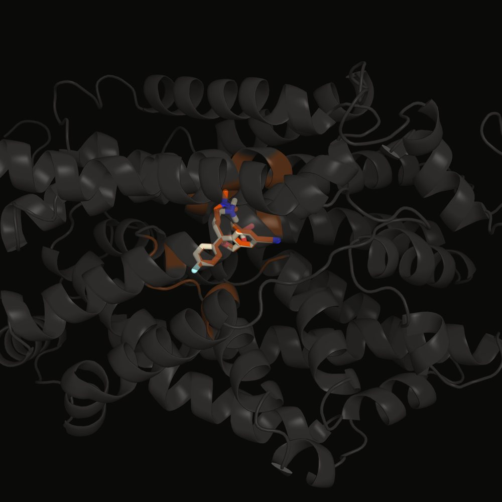
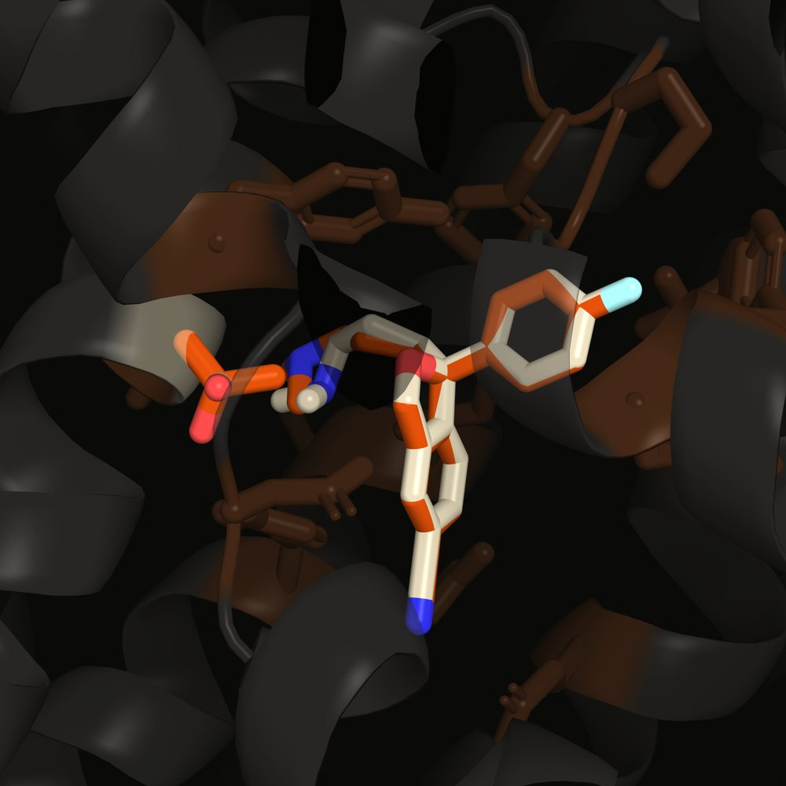

# SERT S438T — Computational Pharmacology of Escitalopram Binding

**Fabian A. Alvarez-Primo, Ph.D.**
*Computational Structural Biology | Psychiatric Pharmacogenomics*

---

## Overview

A computational structural biology study of the **S438T** point mutation in the human Serotonin Transporter (SERT, *SLC6A4*) and its effect on escitalopram (SSRI) binding affinity.

This work originated from iPSC-based transcriptomic analysis of post-mortem brain tissue from patients with major depressive disorder, which surfaced SERT pharmacogenomic variants as a mechanistic question. This repository addresses that question at the molecular level: does S438T — experimentally associated with 320-fold reduced escitalopram affinity — reproduce under rigid-receptor computational docking, and what does the discrepancy reveal about the limits of static structural models?

**Companion work:** A forthcoming transcriptomics review, *"Cell-Type-Resolved Transcriptomics in Mood and Psychotic Disorders,"* contextualizes these findings within the broader pharmacogenomics of antidepressant response across MDD, schizophrenia, and bipolar disorder.

---

## Key Result

Five-seed ensemble docking (AutoDock Vina 1.2.5, exhaustiveness 32, seeds 42 / 123 / 456 / 789 / 1001):

| Receptor model | Wild-type SERT (Ser438) | S438T mutant (Thr438) | ΔΔG (S438T − WT) |
|:---|:---:|:---:|:---:|
| Rigid | −8.575 ± 0.013 | −8.306 ± 0.015 | **+0.269 kcal/mol** |
| Flexible side chains | −8.527 ± 0.003 | −8.317 ± 0.014 | **+0.210 kcal/mol** |

Affinities in kcal/mol, mean ± SD. Sources: `output/multiseed_docking_report.txt`,
`output/flex_multiseed_docking_summary.json`.

Docking predicts the experimental direction: escitalopram binds the S438T mutant more weakly
in both receptor models. The experimental 320-fold *K*i increase (Andersen *et al.*, 2009)
corresponds to roughly +3.4 kcal/mol, about 13× the docking ΔΔG. That gap fits what docking can
see here: the wild-type and S438T poses almost coincide (below), so the substitution likely acts
on the dynamic binding pathway rather than the bound pose, and that is what the staged
molecular dynamics pipeline is built to measure.

| Whole transporter | S1 pocket |
|:---:|:---:|
|  |  |

*Top-ranked Vina poses. Wild-type in cream, S438T in orange; residue 438 and binding-site
residues within 5 Å shown. Rendered in PyMOL from `output/docked_wt.pdbqt` and `output/docked_s438t.pdbqt`.*

> **Revision (2026-10-27):** an earlier single-seed run (exhaustiveness 8) gave
> ΔΔG = −0.2 kcal/mol, within that run's own search noise. The multi-seed results above replace it.

---

## Computational Pipeline

```
PDB 5I6Z (hSERT crystal structure)
    ↓
Chain A extraction + provenance verification (structural_audit.py)
    ↓
In silico S438T mutagenesis — NERF algorithm, g+ rotamer (generate_s438t.py)
    ↓
Receptor PDBQT preparation (docking_prep.py)
    ↓
Escitalopram 3D conformation — RDKit MMFF, SMILES → PDBQT (generate_ligand_pdbqt.py)
    ↓
AutoDock Vina 1.2.5 — S1 binding pocket, 25×25×25 Å grid (output/vina_*.conf)
    ↓
Multi-seed validation redocking (docking_multiseed.py, validation_redock.py)
    ↓
ChimeraX structural analysis (sert_analysis.cxc)
```

---

## Repository Structure

```
data/
  sequences/          FASTA files — 5I6Z, 5I71
  structures/         Processed structures: wild-type chain A, S438T mutant,
                      energy-minimized variants (raw RCSB files not included — see below)

scripts/
  generate_s438t.py         In silico mutagenesis (NERF algorithm, g+ rotamer)
  docking_prep.py           Receptor PDBQT generation, Vina config
  generate_ligand_pdbqt.py  Escitalopram PDBQT from SMILES via RDKit
  structural_audit.py       PDB provenance verification
  validation_redock.py      Crystal ligand redocking validation (RMSD check)
  docking_multiseed.py      Multi-seed ensemble docking
  generate_mutants.py       Additional mutant generation utilities
  Energy_Minimization.py    OpenBabel energy minimization
  sert_analysis.cxc         ChimeraX session script
  generate_mutants.cxc      ChimeraX mutagenesis script

notebooks/
  Escitalopram_PythonPDB.ipynb    RDKit 3D conformation from SMILES
  REVERSE TRANSLATION.ipynb       Amino acid → DNA reverse translation

output/
  5i6z_A_true.pdb / 5i6z_A_S438T.pdb   Processed structures
  receptor_wt.pdbqt / receptor_s438t.pdbqt
  docked_wt.pdbqt / docked_s438t.pdbqt
  vina_wt.log / vina_s438t.log          Full pose tables
  docking_results_report.txt            Summary with interpretation
  validation_report.txt / structural_audit_report.txt

md/                                     Phase 4 MD pipeline (FUTURE_WORK.md)
                                         -- scaffolded, not yet executed: no
                                         CHARMM-GUI/CGenFF export or working
                                         GROMACS build exists in this repo yet
  scripts/        staged WT+S438T pipeline: import -> minimize ->
                  equilibrate -> production -> per-system analysis ->
                  06_compare_systems.py (the WT-vs-S438T comparison),
                  see docs/research/MD_METHODOLOGY.md
  system_prep/    wt/ and s438t/ -- CHARMM-GUI outputs, topology/coordinates
  analysis/       wt/, s438t/, comparison/ -- RMSF, Na+ coordination,
                  pocket-volume output (written by md/scripts/)

tests/                                  pytest coverage for md/scripts/ gate logic

docs/
  research/
    S438T_RESEARCH_ARTICLE.md/.html     Primary research article
    REVIEW_ARTICLE.md/.html             Structure-function review with experimental context
    PLENGE_ALIGNMENT_REVIEW.md/.html    Alignment vs. Plenge (2020) and Andersen (2009)
    2A65_v_5I6Z_Comparison.md           LeuT vs. hSERT structural comparison
    FUTURE_WORK.md                      MD simulation roadmap
    MD_METHODOLOGY.md                   Phase 4 pipeline design (md/scripts/)
  guides/                               ChimeraX and workflow guides
  archive/                              Working documents and superseded reports
```

---

## Replication

See [`REPLICATION_GUIDE.md`](REPLICATION_GUIDE.md) for full setup instructions.

**Raw PDB structures** (excluded from repo — large, publicly available):
```
5I6Z — https://www.rcsb.org/structure/5I6Z  (hSERT + escitalopram, Coleman 2016)
5I71 — https://www.rcsb.org/structure/5I71  (hSERT apo)
2A65 — https://www.rcsb.org/structure/2A65  (LeuT reference)
```

**AutoDock Vina binary** — download from https://github.com/ccsb-scripps/AutoDock-Vina/releases

---

## References

1. Coleman, J.A., *et al.* (2016). X-ray structures of the human serotonin transporter. *Science*, 352, 1478–1480. [PDB: 5I6Z]
2. Andersen, J., *et al.* (2009). Location of the antidepressant binding site in the serotonin transporter. *J. Biol. Chem.*, 284, 10276–10284.
3. Plenge, P., *et al.* (2020). The mechanism of a high-affinity allosteric inhibitor of the serotonin transporter. *Nat. Commun.*, 11, 1491.
4. Trott, O., & Olson, A.J. (2010). AutoDock Vina: improving the speed and accuracy of docking. *J. Comput. Chem.*, 31, 455–461.

---

## Related Work

- [`multi-epitope-vaccine-design`](https://github.com/fabzy4L/multi-epitope-vaccine-design) — computational immunoinformatics pipeline (NetMHCpan, AlphaFold2, RFdiffusion, NetChop) for SARS-CoV-2 multi-epitope vaccine design
- *Cell-Type-Resolved Transcriptomics in Mood and Psychotic Disorders* — forthcoming review (medRxiv); pharmacogenomics section contextualizes SERT variant findings within cell-type-specific transcriptomic dysregulation in MDD/SZ/BD

---

*Independent research. Contact: fpalvarez23@gmail.com*
